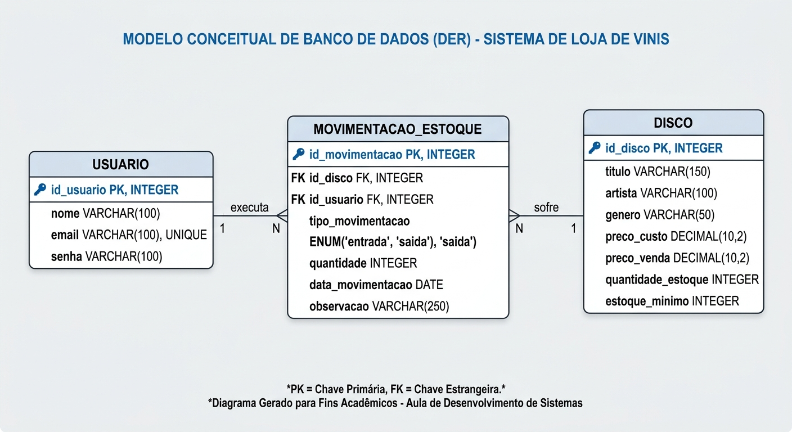

# Requisitos Funcionais - Sistema Vinyl Control — Gestão de Acervo e Vendas

## [RF01] Login
- [RF01.1] Solicitar e-mail e senha.
- [RF01.2] Verificar se os dados estão corretos.
- [RF01.3] Acessar o sistema após o login correto.
- [RF01.4] Informar quando o login estiver incorreto.

## [RF02] Tela principal
- [RF02.1] Exibir o nome do usuário logado.
- [RF02.2] Mostrar as opções de cadastro de discos e gestão de estoque.
- [RF02.3] Permitir sair do sistema (logout).

## [RF03] Cadastro de discos
- [RF03.1] Listar os discos cadastrados.
- [RF03.2] Permitir cadastrar novos discos.
- [RF03.3] Permitir editar e excluir discos.
- [RF03.4] Permitir buscar discos pelo título ou artista.
- [RF03.5] Registrar título, artista/banda, preço de custo, quantidade em estoque e estoque mínimo.
- [RF03.6] Verificar se os dados informados são válidos.

## [RF04] Gestão de estoque e vendas
- [RF04.1] Exibir os discos em ordem alfabética.
- [RF04.2] Permitir selecionar um disco e o tipo de movimentação (venda ou reposição).
- [RF04.3] Permitir informar a data e a quantidade da movimentação.
- [RF04.4] Diminuir o estoque nas vendas.
- [RF04.5] Aumentar o estoque nas reposições.
- [RF04.6] Avisar quando o estoque ficar abaixo do mínimo.

## [RF05] Histórico de movimentações
- [RF05.1] Registrar as vendas e reposições realizadas.
- [RF05.2] Armazenar a data, a quantidade e o tipo de movimentação.
- [RF05.3] Registrar o usuário responsável por cada movimentação.

---

## Diagrama entidade relacionamento (DER)
